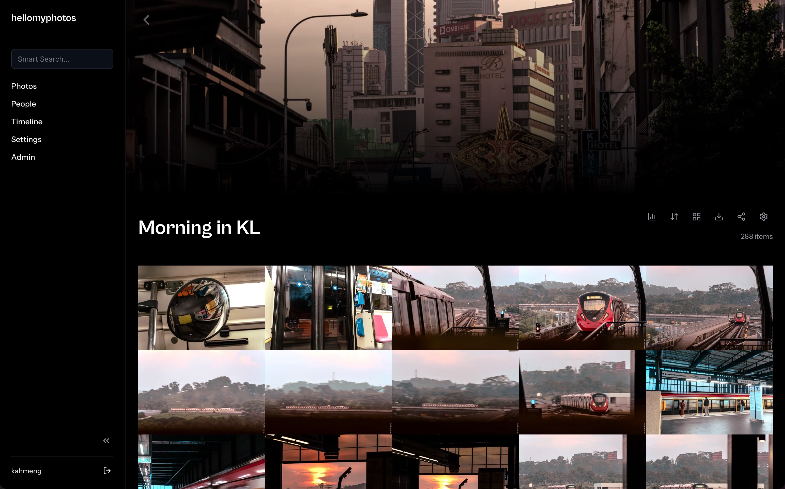

# hellomyphotos 📸

A beautiful, self-hosted, directory-first photo management gallery engine. It reads directly from your existing disk folder hierarchies without moving or duplicating files, bringing Google Photos-like speed, semantic AI search, and facial recognition capabilities to your local storage.



---

## 🌟 Key Features

- **Directory-First Engine**: Leave your folders exactly as they are. hellomyphotos scans your media on-demand without modifying original files.
- **High Performance**: Optimized virtualized grid capable of smoothly rendering thousands of thumbnails with Blurhash placeholders.
- **Smart Semantic Search**: Powered by Immich ML CLIP model and `pgvector` HNSW index—search your photos using natural language (e.g. "sunset on beach", "birthday party", "dog playing").
- **AI Facial Recognition**: Powered by Immich ML (SCRFD + Buffalo_L), automatically detects, clusters, and organizes your photos by person with face thumbnail generation and person management.
- **Timeline View**: Chronological photo feed grouped by year and month from EXIF capture dates.
- **Dynamic Watermark Studio**: Create and customize watermark templates (dynamic SVG overlays, custom typography, logo, anchors, tiling, rotation, and restricted download tiers).
- **Granular Sharing & Access Control**: Share by folder, single photo, or person cluster. Features password protection, expiry, folder ZIP bulk downloads, and an expired share access request system with email notifications.
- **Analytics & GeoIP Tracking**: In-depth visitor analytics with device fingerprinting, MaxMind GeoLite2 country/city resolution, and cache bandwidth tracking.
- **Low-Bandwidth Mode**: Switch to 480p delivery for mobile data savings.
- **Automated Backups & Robust Stack**: Built with SvelteKit, Fastify, PostgreSQL + pgvector, Redis, BullMQ, and scheduled automated daily database backups.

---

## 🚀 Quick Start — Docker Compose

The simplest way to run hellomyphotos is with Docker Compose. It runs the full stack: frontend, backend API + workers, PostgreSQL (pgvector), Redis, Immich ML engine, and automated daily database backups.

### 1. Prerequisites
- **Docker** and **Docker Compose** (with buildx for local builds)

### 2. Clone the repository
```bash
git clone https://github.com/KahMeng15/hellomyphotos.git
cd hellomyphotos
```

### 3. Configure the environment
```bash
cp .env.example .env
```
Edit `.env` and at minimum set:
- `APP_DOMAIN` / `PUBLIC_APP_DOMAIN` — the URL you use to reach the app (e.g. `http://localhost:8000` locally, `https://photos.mydomain.com` in production).
- `DB_PASS` / `POSTGRES_PASSWORD` — change the default database password.
- `JWT_SECRET` and `COOKIE_SECRET` — add long random strings (`openssl rand -hex 48`).
- `TURNSTILE_SITEKEY` / `TURNSTILE_SECRET` — your Cloudflare Turnstile pair (the defaults are Cloudflare's *always-pass* test keys).
- *(Optional)* `SMTP_*` — configure SMTP credentials if you wish to receive email notifications when visitors request access to expired shares.

### 4. (Optional) Download GeoIP Databases
To enable country and city visitor analytics, download the MaxMind GeoLite2 MMDB databases:
```bash
./scripts/download-geoip.sh
```

### 5. Add your photos
The scanner reads directly from `./volumes/media_ro` (mounted read-only — your originals are never modified).
```bash
mkdir -p volumes/media_ro/test_folder
# Add some .jpg, .png, or .mp4 files here!
```

### 6. Start the stack
Pull the prebuilt multi-arch images from GitHub Container Registry and start:
```bash
docker compose up -d
```
> The images (`ghcr.io/kahmeng15/hellomyphotos/frontend:latest` and `backend:latest`) are multi-arch (linux/amd64 + linux/arm64), so they run natively on both Intel and Apple Silicon Macs, and on ARM servers.

**Or build from source** (uses your local code instead of published images):
```bash
docker compose up -d --build
```

On first boot, PostgreSQL initializes the schema and seeds the default admin account from `volumes/pg_init`. Give it ~30 seconds before visiting the UI.

### 7. Access the application
| Service | URL |
| --- | --- |
| Frontend UI | http://localhost:8000 |
| Redis (diagnostics) | http://localhost:8003 |
| Immich ML (health) | http://localhost:8004 |

The backend API is **not** exposed to the host. The frontend proxies all `/api/*` calls to it internally.

### 8. Backup, restore & helper scripts
Utility scripts are located in `./scripts`:
```bash
# Trigger an immediate manual database backup
./scripts/backup.sh

# Restore the database from a backup
./scripts/restore.sh volumes/backups/daily/<backup-file>.sql.gz

# Download / update MaxMind GeoLite2 databases
./scripts/download-geoip.sh
```

### 9. Update / stop / teardown
```bash
# Pull the latest images and recreate changed containers
docker compose pull && docker compose up -d

# Stop all containers (data is preserved)
docker compose down

# Stop AND delete all volumes (postgres data, cache, redis, backups) — full reset
docker compose down -v
```

---

## 🧱 Services & Data Locations

| Container | Image / Role | Host port |
| --- | --- | --- |
| `frontend` | SvelteKit node server (serves the UI + proxies `/api`) | `8000` |
| `backend` | Fastify API, auth, streaming, queue dispatch | internal |
| `backend-worker` | BullMQ background workers (thumbnails, ffmpeg, ML, clustering, smart search) | internal |
| `postgres` | `ankane/pgvector` — metadata, embeddings, shares, analytics | internal |
| `db-backup` | `prodrigestivill/postgres-backup-local:16-alpine` — scheduled daily DB dumps | internal |
| `redis` | BullMQ + caching + analytics buffer | `8003` |
| `machine-learning` | Immich ML — face detection + CLIP embeddings | `8004` |

Persistent data lives under `./volumes/`:
- `media_ro/` — your photos (read-only mount; add files here to be scanned)
- `cache_rw/` — generated thumbnails, transcoded videos, watermarks, face avatars
- `pg_data/` — PostgreSQL data (**back this up**)
- `backups/` — automated daily and manual PostgreSQL `.sql.gz` backups
- `geoip/` — MaxMind GeoLite2 MMDB databases for country/city analytics
- `redis_data/` — Redis persistence
- `ml_cache/` — ML model weights (downloaded on first use)
- `pg_init/` — SQL run automatically on first DB initialization

---

## 🔐 Default Credentials

A default administrator account is seeded on first start:

- **Email:** `admin@example.com`
- **Password:** `admin`

> **Note:** Please change this password immediately after your first login!

---

## 📚 Documentation

- **[Technical Documentation](tech_docs.md)** — architecture, database schema, background worker system, API details, deployment & security checklists.
- **[Local Development Guide](tech_docs.md#7-local-development-guide)** — hot-reloading dev stack and non-Docker local development.
